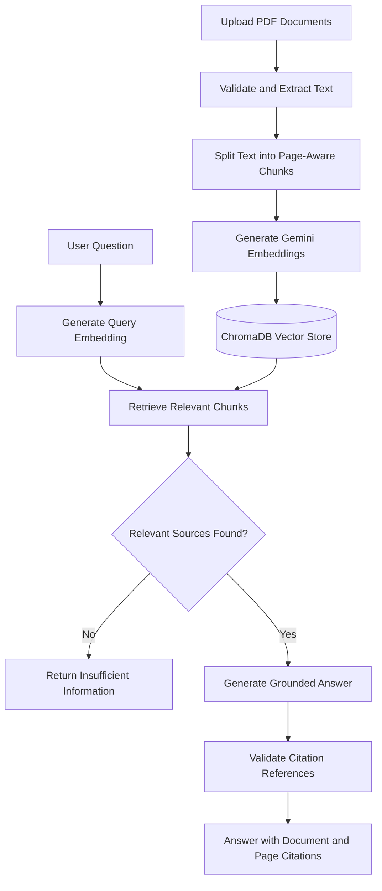

# IntelliDocs — AI-Powered Document Assistant

**Ask questions about your PDFs and get document-grounded answers with page-level source citations.**

IntelliDocs is a Retrieval-Augmented Generation (RAG) application that lets users upload PDF documents, search their content semantically, and ask questions in natural language. It uses Google Gemini for embeddings and answer generation, ChromaDB for vector storage, and Streamlit for the interactive interface.

<p align="center">
  <a href="https://intellidocs-rag-o29aswn7basw4jmoyjgrbi.streamlit.app/"><strong>🚀 Live Demo</strong></a>
  &nbsp; | &nbsp;
  <a href="https://github.com/MounikaChelamsetti/intellidocs-rag"><strong>💻 GitHub Repository</strong></a>
</p>

## ✨ Key Features

- **Multi-PDF Upload:** Upload multiple documents with file validation and duplicate detection.
- **PDF Processing:** Extract text page by page and identify documents that require OCR.
- **Configurable Chunking:** Split text into overlapping, page-aware chunks for precise source attribution.
- **Semantic Search:** Generate Gemini embeddings and retrieve relevant passages using ChromaDB cosine similarity.
- **Grounded Answers:** Generate responses using retrieved document passages rather than relying solely on general model knowledge.
- **Citation Validation:** Validate source reference IDs and remove invalid citations.
- **Source Transparency:** Display document names, PDF page numbers, retrieval scores, and source passages.
- **Context-Aware Chat:** Use conversation history to improve retrieval for follow-up questions.
- **Evaluation Dashboard:** Explore retrieval evaluation results and run reproducible experiments.
- **Offline Demo Mode:** Demonstrate retrieval and extractive answers without a live Gemini API call.

## 🛠️ Tech Stack

| Component | Technology |
|---|---|
| Frontend | Streamlit |
| Language | Python |
| LLM and embeddings | Google Gemini API |
| Vector database | ChromaDB |
| PDF processing | pypdf |
| Evaluation and testing | pytest, Streamlit AppTest |
| Deployment | Streamlit Community Cloud |

## 🏗️ Architecture



## 🔍 How It Works

1. **Document ingestion:** Validate uploaded PDFs and extract text with page metadata.
2. **Chunking:** Split extracted text into configurable word-based chunks without crossing page boundaries.
3. **Embedding:** Generate document and query embeddings using Gemini.
4. **Vector storage:** Store embeddings and metadata in a session-specific ChromaDB collection.
5. **Retrieval:** Find the top-k relevant chunks and filter them using a configurable relevance threshold.
6. **Answer generation:** Ask Gemini to answer using the retrieved passages and cite supporting sources.
7. **Citation validation:** Check citation IDs against the retrieved passages and remove invalid references.

When no chunks meet the relevance threshold, the application can decline to generate an answer rather than making an unsupported claim.

## 🚀 Run Locally

### Prerequisites

- Python 3.11 or later; Python 3.12 was used during development.
- A Gemini API key for live mode.

### 1. Clone the repository

```bash
git clone https://github.com/MounikaChelamsetti/intellidocs-rag.git
cd intellidocs-rag
```

### 2. Create a virtual environment

**Windows PowerShell**

```powershell
python -m venv .venv
.\.venv\Scripts\Activate.ps1
```

**macOS / Linux**

```bash
python -m venv .venv
source .venv/bin/activate
```

### 3. Install dependencies

```bash
python -m pip install -r requirements.txt
```

### 4. Configure the API key

Copy `.env.example` to `.env` and add your own Gemini API key:

```dotenv
GEMINI_API_KEY=your_gemini_api_key_here
```

Keep the real key in `.env` or your deployment's secret manager. **Never commit API keys to GitHub.**

Get a key from [Google AI Studio](https://aistudio.google.com/apikey).

### 5. Start the application

```bash
python -m streamlit run app.py
```

Open the local URL displayed in your terminal, upload a PDF, click **Process Documents**, and ask a question.

## 🌐 Live Deployment

Try IntelliDocs online:

**[Open the IntelliDocs Live Demo](https://intellidocs-rag-o29aswn7basw4jmoyjgrbi.streamlit.app/)**

The application is hosted on Streamlit Community Cloud. The live deployment requires a valid Gemini API key configured through Streamlit Secrets.

Uploaded documents and vector data are stored in memory for the active session. They may need to be uploaded again after a session ends or the application restarts.

## 🧪 Testing and Evaluation

Run the automated test suite:

```bash
python -m pip install -r requirements-dev.txt
python -m pytest -q
```

The recorded development test run reported **75 passing tests**. The tests cover PDF processing, chunking, retrieval, citation validation, error handling, configuration, evaluation logic, and application behavior. External API calls are mocked in the automated tests.

### Recorded Offline Retrieval Baseline

The repository includes an offline evaluation using three fictional PDFs, 11 pages, and 25 evaluation cases. This baseline uses a lexical hashing-based embedder rather than Gemini embeddings.

| Metric | Recorded result |
|---|---:|
| Recall@1 | 0.765 |
| Recall@3 | 0.941 |
| Recall@5 | 1.000 |
| Unanswerable questions blocked by relevance filtering | 4 of 8 |

These results describe a small offline retrieval experiment, **not the live Gemini system's answer quality**. The live system's accuracy, citation entailment, latency, and cost have not been established by these measurements.

Run the offline evaluation with:

```bash
python evaluation/run_evaluation.py --mode offline
```

For the live evaluation, use:

```bash
python evaluation/run_evaluation.py --mode live
```

The live evaluation requires valid API credentials and may incur API usage.

## 📁 Project Structure

```text
intellidocs-rag/
├── app.py                         # Streamlit application
├── src/
│   ├── config.py                  # Configuration
│   ├── pdf_processor.py           # PDF extraction and validation
│   ├── chunker.py                 # Page-aware text chunking
│   ├── embeddings.py               # Embedding generation
│   ├── vector_store.py            # ChromaDB integration
│   ├── retriever.py               # Semantic retrieval
│   ├── prompts.py                 # Grounded-generation prompts
│   ├── citations.py                # Citation validation
│   ├── llm.py                     # Answer generation
│   ├── rag_pipeline.py            # RAG orchestration
│   └── evaluation.py              # Evaluation metrics
├── data/
│   └── sample_documents/          # Fictional example PDFs
├── evaluation/
│   ├── questions.json             # Evaluation cases
│   ├── run_evaluation.py           # Evaluation runner
│   └── results/                   # Recorded evaluation results
├── tests/                         # Automated tests
├── docs/                          # Architecture and project notes
├── requirements.txt
├── requirements-dev.txt
└── README.md
```

## ⚠️ Limitations

- Scanned PDFs require OCR, which is not currently implemented.
- Complex tables, diagrams, and image-based content may not be extracted accurately.
- Page-aware chunking can lose context spanning multiple pages.
- Citation validation checks reference validity, not whether each citation logically supports its claim.
- The evaluation dataset is small and uses fictional sample documents.
- Session data is not designed for permanent storage.
- Authentication, rate limiting, and production-grade access controls are not currently implemented.
- Gemini API quotas, model availability, response latency, and answer quality depend on the configured service and require live testing.

## 🔮 Future Improvements

- Add OCR support for scanned documents.
- Implement hybrid retrieval and reranking.
- Evaluate semantic retrieval and answer quality on a larger dataset.
- Add stronger citation entailment checks.
- Introduce persistent storage and document management.
- Add authentication, rate limiting, and usage monitoring.
- Improve deployment observability and error reporting.

## 🔐 Security

- Store API keys in environment variables or deployment secrets.
- Do not upload `.env` or real credentials to the repository.
- Validate uploaded files before processing.
- Treat document contents as untrusted input.
- Keep document collections scoped to individual application sessions.

## 📄 License

This project is licensed under the MIT License. See [LICENSE](LICENSE) for details.
