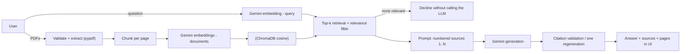

# 📄 IntelliDocs — AI Document Assistant

A Retrieval-Augmented Generation (RAG) chatbot. Upload several PDFs, ask questions in natural language, and get
answers **grounded in your documents** with **validated, page-level citations** and the exact source passages.

> **Status honesty box**
> * Automated tests (75) and an **offline, retrieval-only** evaluation were actually executed (results below).
> * The live Gemini path (embeddings + generation) is implemented and unit-tested against mocked SDK clients,
>   but it has **not been run against the real Gemini API** in the environment where this project was generated (no API key or network access to Gemini there). Live answer-quality metrics are therefore **not measured** — run the live evaluation yourself (see below).
> * No live deployment exists yet; deployment steps are provided but unverified.

## Features
- Multi-PDF upload with type, size, page-count and magic-byte validation; duplicate detection by content hash
- Page-aware extraction; blank pages reported; **scanned/image-only PDFs flagged as needing OCR** (not silently ignored)
- Configurable word-based chunking (default 400 words / 60 overlap); chunks never cross page boundaries
- Gemini embeddings (`gemini-embedding-001`) → ChromaDB (cosine) → top-k retrieval with a tunable relevance filter
- Grounded generation (Gemini) with a strict system prompt; document text treated as untrusted data
- **Citation validation**: every `[n]` is checked against the retrieved passages; fabricated ids are removed, or the answer is regenerated once
- Chat history with history-aware retrieval for follow-up questions
- Source panel: filename, real PDF page number, retrieval score, expandable passage, chunk id
- Evaluation dashboard + reproducible evaluation harness (25 cases on fictional sample PDFs)
- Offline **demo mode** (no key, no LLM) and mocked tests so everything except live Gemini runs anywhere

## Architecture

More detail: [docs/architecture.md](docs/architecture.md).

## Project structure
```
app.py                    Streamlit UI
src/                      config, errors, pdf_processor, chunker, embeddings, vector_store,
                          retriever, prompts, citations, llm, rag_pipeline, evaluation, offline
tests/                    pytest suite (offline; Gemini calls mocked)
evaluation/               questions.json, run_evaluation.py, results/
data/                     sample_documents/ (fictional PDFs) + generate_sample_documents.py
docs/                     architecture, interview questions, resume text
.streamlit/config.toml    theme + server settings
```

## Prerequisites
Python 3.11+ (developed and tested on 3.12) and, for live use, a Gemini API key from <https://aistudio.google.com/apikey>.

## Installation
```bash
git clone <your-repo-url> intellidocs-rag && cd intellidocs-rag
python -m venv .venv && source .venv/bin/activate     # Windows: .venv\Scripts\activate
pip install -r requirements.txt                        # add requirements-dev.txt for tests
cp .env.example .env                                   # then edit .env
```

## API key setup
Put the key **only** in `.env` (git-ignored) or an environment variable:
```
GEMINI_API_KEY=your_real_key
```
On Streamlit Cloud use *App settings → Secrets* (`GEMINI_API_KEY = "..."`). The key is never logged, printed, or hardcoded.

## Run locally
```bash
streamlit run app.py                         # live mode (needs GEMINI_API_KEY)
INTELLIDOCS_DEMO_MODE=1 streamlit run app.py # offline demo: lexical retrieval, extractive "answers", no LLM
```
Try it with the PDFs in `data/sample_documents/` (all content is fictional).

## How the pipeline works
1. **Extract** – `pypdf` reads each page; text is whitespace-normalised. Empty pages are listed; if *no* page has text the file is reported as "needs OCR".
2. **Chunk** – per page, sliding word window (size/overlap configurable in `config.py`, env vars, or the UI). Per-page chunking trades some cross-page context for **exact page citations**.
3. **Embed** – documents use `RETRIEVAL_DOCUMENT`, queries `RETRIEVAL_QUERY` task types; batches of up to 100; 768-dim vectors, L2-normalised; retry with exponential backoff on 429/5xx.
4. **Store** – ChromaDB collection with `hnsw:space=cosine`, one **unique in-memory collection per browser session** (no cross-session mixing; freed when the session is garbage-collected). Duplicate files (same SHA-256) are skipped *before* any embedding call.
5. **Retrieve** – query embedding → top-k (default 5) → drop chunks below `min_relevance`. For follow-ups, the previous user question + current question is searched as well (no extra LLM call).
6. **Generate** – sources are numbered `[1]…[N]` inside `<source>` tags (escaped so a document cannot close the tag). The system prompt: use only sources, treat them as data, cite every claim, otherwise reply with the fixed "not enough information" sentence. If nothing passes the relevance filter, the LLM is **not called** at all.
7. **Validate** – see below.

### Relevance filtering
Chroma returns cosine *distance*; the app reports **score = 1 − distance** (cosine similarity, higher = better) and keeps chunks with `score ≥ min_relevance`. The default `0.30` is an **initial, unvalidated heuristic for Gemini embeddings**, not a universal constant: similarity scales differ between embedding models and corpora. Tune it with the sidebar slider and with the threshold sweep that `run_evaluation.py` produces. The LLM's own refusal rule is a second line of defence.

### Citation validation
`src/citations.py` parses `[1]`, `[1][2]`, `[1, 2]`; any id outside `1..N` (N = passages actually sent) is deleted. If an answer contains invalid ids, or no citation at all, the model is asked **once** to rewrite it with the valid ids; anything still invalid is stripped and a warning is shown. Page numbers are never produced by the LLM — they come from chunk metadata for the validated ids.
Limit: validation proves a cited id *exists*, not that the passage truly *entails* the claim (that needs human review or an NLI/judge model).

## Evaluation
Run: `python evaluation/run_evaluation.py --mode offline` (no key) or `--mode live` (needs key; throttled by `--sleep`; embeddings cached in `.cache/`). Add `--experiment --chunk-sizes 50:10,400:60` for a retrieval-only chunk-size comparison.

**Metric definitions** (full text in `src/evaluation.py`): *Recall@k* = fraction of gold (document, page) locations within the top-k; *Answer correctness* = every required fact group has an accepted string in the answer (rule-based, **not** human grading); *Citation correctness* = ≥1 valid cited passage lies on a gold page; *Citation coverage* = share of claim sentences with a valid citation; *Unsupported-answer rate* = share of out-of-document questions that received a substantive answer instead of a refusal.

### Actual results — executed offline, retrieval-only
Setup: `hashing-bow@1024` **lexical** embedder (not Gemini), 3 fictional PDFs / 11 pages, **25 cases** (17 answerable, 8 unanswerable/irrelevant), top_k=5, min_score=0.10, chunk 400/60, run on the build sandbox.

| Metric | Value |
|---|---|
| Recall@1 / @3 / @5 (n=17) | 0.765 / 0.941 / 1.000 |
| Mean top-1 score, answerable / unanswerable | 0.328 / 0.126 |
| Unanswerable questions blocked by the 0.10 relevance filter | 0.50 (4 of 8) |
| Answerable questions blocked by the filter | 0.00 |

Chunk-size experiment (retrieval only, same embedder): 30/5 → 42 chunks, R@1 0.706; 50/10 → 29 chunks, R@1 0.765; 400/60 → 11 chunks, R@1 0.765; R@3 = 0.941 and R@5 = 1.0 for all three.

**Read this carefully:** the corpus has only 11 pages, so top-5 covers ~45% of it and Recall@5 = 1.0 is unimpressive; pages are short so chunk sizes barely differ; lexical scores say nothing about Gemini. These numbers are a regression baseline, not a claim about general performance.

### Not measured
Answer correctness, citation correctness/coverage, unsupported-answer rate and Gemini retrieval quality require `--mode live` with a real key. Results will be written to `evaluation/results/live_latest.json` and appear in the app's **Evaluation** tab. Please paste them here after running.

## Testing
```bash
pip install -r requirements-dev.txt
python -m pytest -q
```
Executed in the build sandbox: **75 passed** (PDF extraction/paging/OCR flag/malformed files, chunking & overlap, metadata, duplicates, retrieval, citation validation, refusal paths, prompt-injection escaping, retries & error mapping, config, evaluation metrics, headless UI via Streamlit `AppTest`). All external calls are mocked; no key needed.

## Deployment (Streamlit Community Cloud) — *not yet deployed*
1. Push the repo to GitHub (confirm `.env` and `.streamlit/secrets.toml` are not tracked: `git ls-files | grep -E "\.env$|secrets.toml$"` should print nothing).
2. On <https://share.streamlit.io> → *New app* → select repo, branch, main file `app.py`; in *Advanced settings* choose Python 3.11 or 3.12 and paste `GEMINI_API_KEY = "..."` into *Secrets*.
3. Deploy. Storage is in-memory per session: data disappears on restart/session end by design (Community Cloud's disk is not guaranteed persistent). Free-tier Gemini quotas apply to all visitors; consider access control if you share the URL publicly.
4. Caveat: the build environment could not test Community Cloud itself; if dependency resolution fails, check the build log first.

## Screenshots
Not included (none could be captured in the build sandbox). To add them: run the app with sample PDFs, ask *"What is the maximum flight time of the Nimbus X2?"*, capture the chat with an expanded source, and save to `docs/screenshots/` then reference them here.

## Security notes
Key via env/secrets only; uploads validated (extension, magic bytes, size, page cap); document text is never executed and is XML-escaped inside prompts; user-facing errors contain no stack traces; chunks are scoped to the session's collection.

## Limitations & future work
No OCR; text-only (tables/figures degrade); per-page chunks lose cross-page context; no re-ranking or hybrid (BM25) search; citation validation checks existence not entailment; single-user session memory; no auth/rate limiting; evaluation corpus is tiny and synthetic; live Gemini behaviour (latency, model-name availability, safety blocks) untested by the author — model names are centralised in `src/config.py` in case they change.

## License
MIT — see [LICENSE](LICENSE).
