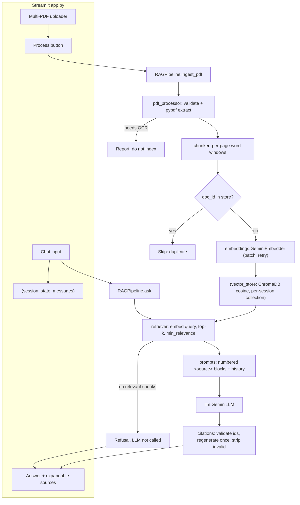

# Architecture

## Module responsibilities
| Module | Responsibility |
|---|---|
| `config.py` | Settings dataclass, env/secrets loading, validation |
| `pdf_processor.py` | Upload validation, per-page extraction, OCR-needed detection, content-hash doc ids |
| `chunker.py` | Page-bounded sliding word windows with metadata |
| `embeddings.py` | Gemini embedder (batching), disk-cache wrapper |
| `gemini_utils.py` | Client creation, error translation, exponential backoff |
| `vector_store.py` | ChromaDB wrapper (cosine), duplicate check, reset, per-session collection |
| `retriever.py` | Query embedding, multi-query merge, relevance filter |
| `prompts.py` | System prompt, escaped source blocks, history formatting |
| `citations.py` | Citation parsing/validation, coverage |
| `rag_pipeline.py` | Orchestration, regeneration policy, result objects |
| `evaluation.py` | Metric definitions and case runners |
| `offline.py` | Lexical embedder + extractive demo "LLM" (demo/tests only) |

## Key design decisions
- **Page-bounded chunks** → each retrieved passage maps to exactly one page, so citations cannot be off by a page.
- **Cosine similarity, score = 1 − distance**; threshold is configurable, not hard-claimed.
- **Per-session ephemeral collections** → no cross-user leakage; no false persistence promises on Streamlit Cloud.
- **No LLM call when nothing is relevant** → cheaper, and removes one hallucination path.
- **Page numbers come from metadata, never from the LLM.**
- **Dependency-injected embedder/LLM** → the whole pipeline is testable offline.
